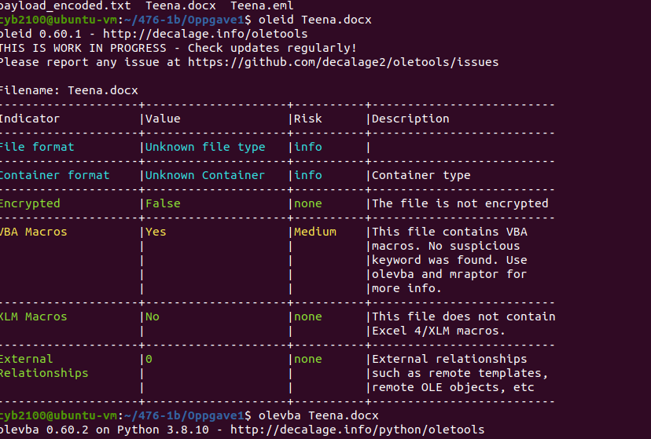
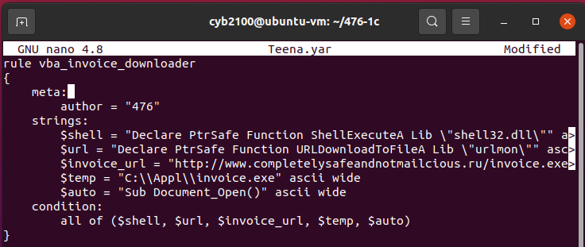
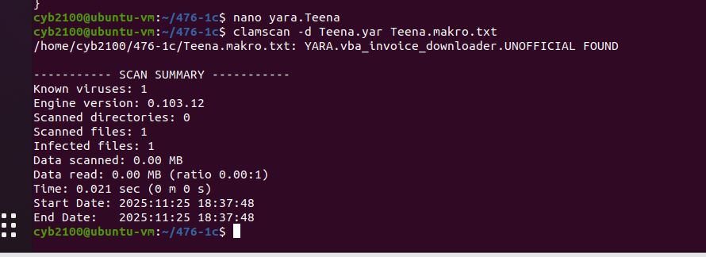

# Deteksjon med YARA og ClamAV

Skrev en YARA-regel som oppdager et ondsinnet Office-dokument, og kjørte den gjennom ClamAV.

## Oversikt

Scenarioet ga meg en passordbeskyttet ZIP-fil med et Word-dokument som inneholdt en ondsinnet VBA-makro. Siden arkivet var kryptert og innpakningen lett kunne endres, ville en signatur basert på selve filinnpakningen vært skjør. Det var makroen som inneholdt den faktiske nyttelasten, så det var det mest pålitelige stedet å detektere på.

## Hva jeg gjorde

- Åpnet og dekrypterte e-posten som leverte filen, og låste opp dokumentet med passordet fra meldingen
- Analyserte dokumentet med **oletools** (`oleid`, `olevba`) og bekreftet at det inneholdt VBA-makroer som fungerte som laster
- Skrev en **YARA-regel** rettet mot de særegne tekststrengene i makroen: deklarasjonene `ShellExecuteA` og `URLDownloadToFileA`, nedlastingsadressen, stien til filen som slippes, og den automatiske starten `Sub Document_Open()`
- Skannet prøven med **ClamAV** (`clamscan -d`) med den egne regelen og bekreftet en ren deteksjon

## Hvorfor detektere på makroen

Det er makroen som gjør skaden, så en regel bygget på innholdet i den holder seg selv om angriperen pakker om eller krypterer filen på nytt. Ved å kreve treff på flere uavhengige strenger (`all of`) holdes falske treff nede, samtidig som regelen tåler små endringer.

## Skjermbilder

Undersøkelse av dokumentet med oletools, makroer bekreftet:

YARA-regelen, som treffer på de særegne strengene i makroen:

Skanning av prøven med ClamAV og den egne regelen, deteksjon bekreftet:

Selve regelen ligger i [`Teena.yar`](Teena.yar).

## Verktøy og begreper

YARA · ClamAV · oletools (oleid, olevba) · analyse av VBA-makroer · design av signaturer

## Hva jeg lærte

Å skrive en regel selv gjorde avveiningen tydelig: detekterer du for spesifikt, går du glipp av neste variant, og detekterer du for løst, drukner du i falske treff. Å forankre regelen i oppførselen som faktisk gjør skaden, er den beste balansen.
